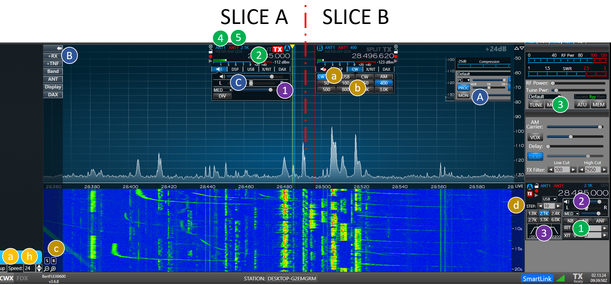
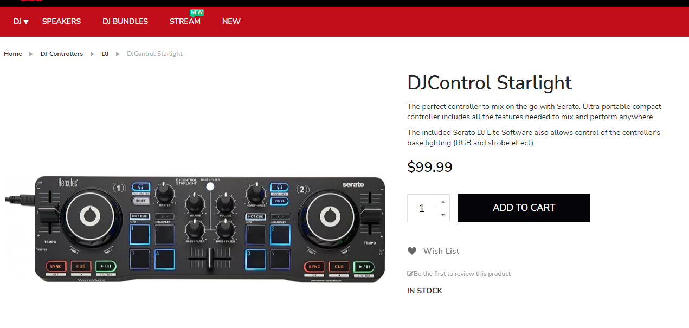
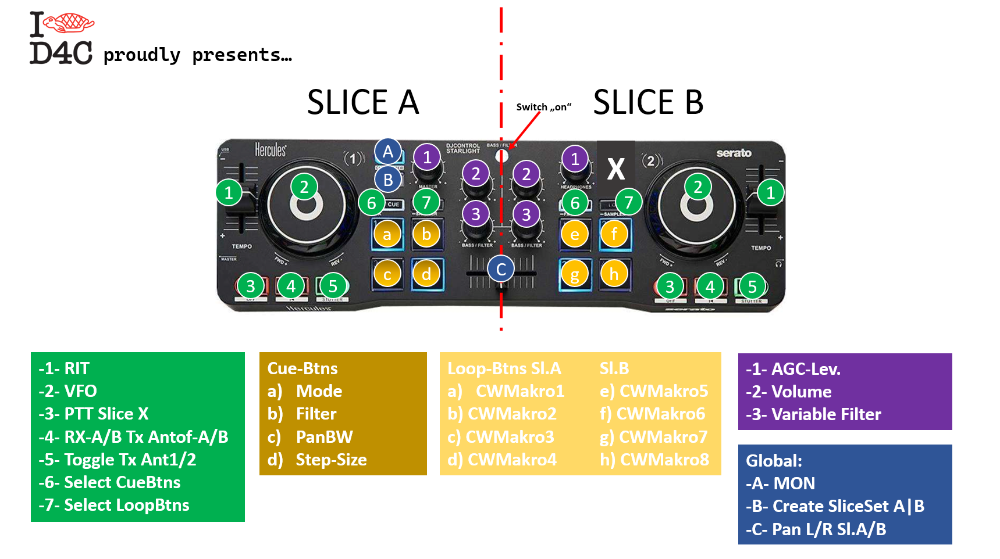
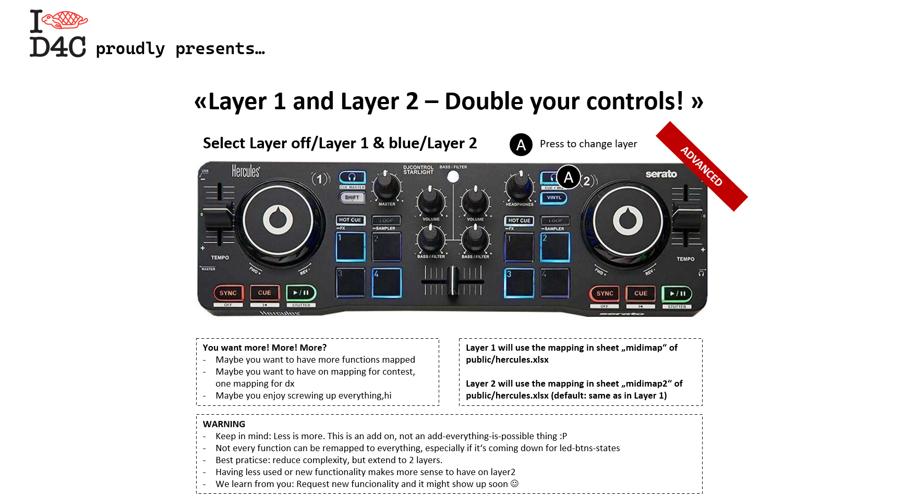
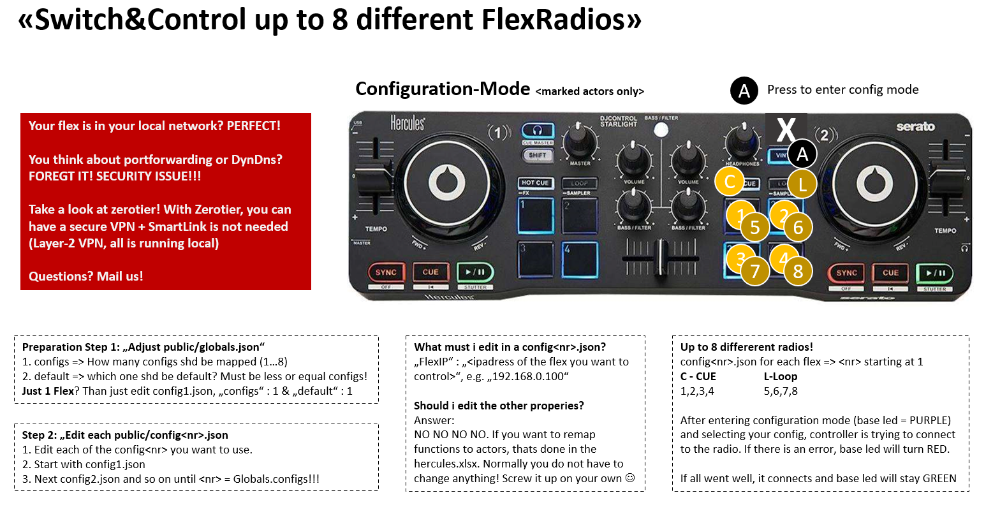
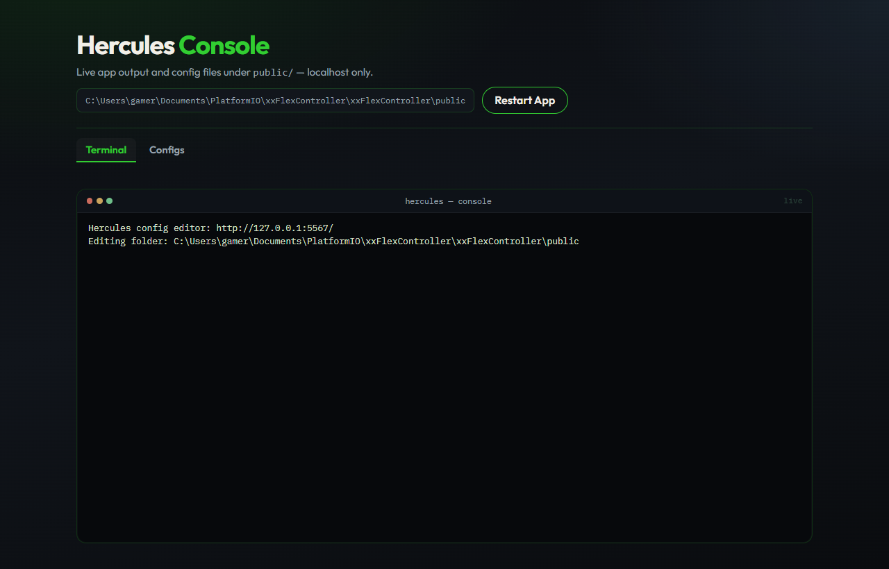
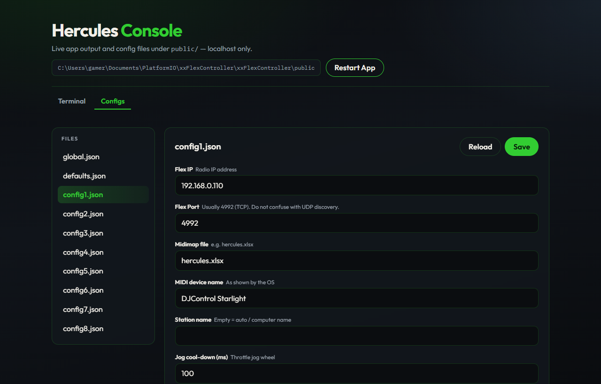

# Hercules — Benutzerhandbuch

**xxFlexradioController „Hercules“**  
DJ Control Starlight → FlexRadio 6xxx / 8xxx (SmartSDR **oder** AetherSDR)


<p class="cover-note"><em>I ♥ D4C — DM5XX — GPL-3.0 · Optik angelehnt an <code>rh.pdf</code></em></p>

| Feld | Beispiel | Kurz |
|------|----------|------|
| Produkt | `xxHercules.exe` | Windows-Programm aus dem Download-ZIP |
| Handbuch | `public/newmanual.pdf` | diese Datei (Markdown: `newmanual.md`) |
| Älteres PDF | `public/rh.pdf` | Vorgänger-Handbuch |
| Build im Overlay | `Build 2026102505` | Format `yyyymmddxx` in `OverlayText` |

---

## 1. Was ist Hercules?

Hercules verbindet einen **Hercules DJ Control Starlight** (USB-MIDI) mit einer **FlexRadio** über die SmartSDR-TCP-API. Kein Node-RED, kein Raspberry nötig.

- Frequenz, Mode, Filter, Volume, RIT/XIT, Antennen, Pan-BW, PTT, CW-Makros, SO2R-Fader, …
- **Zwei Layer** → bis ~86 Belegungen
- Bis zu **8 Profile** (`config1.json` … `config8.json`)
- GUI: **SmartSDR oder AetherSDR** auf demselben PC (MultiFlex), Auto-`client bind`



---

## 2. Installation (Download-ZIP)

Endnutzer bekommen **`rh.zip`** (kein `dist/`-Ordner nötig). Nach dem Entpacken typisch:

```text
irgendwo/mein-hercules/
  xxHercules.exe
  public/
    global.json
    config1.json
    …
    hercules.xlsx
    newmanual.pdf
```

| Schritt | Beispiel | Bedeutung |
|---------|----------|-----------|
| 1. ZIP holen | `rh.zip` von GitHub Releases / Download-Link | komplettes Windows-Paket |
| 2. Entpacken | Ordner `Hercules` auf dem Desktop | EXE und `public/` müssen **nebeneinander** liegen |
| 3. Starten | Doppelklick `xxHercules.exe` | Arbeitsverzeichnis = Ordner der EXE |
| 4. Config | `public/config1.json` → `FlexIP` | oder Browser-Tab **Configs** |
| 5. GUI | SmartSDR **oder** AetherSDR lokal | Slice-/MultiFlex-Bind |

> **Wichtig:** Configs immer unter dem `public/` **neben der EXE** ändern — nicht irgendwo im Git-Quellbaum, wenn du nur das ZIP nutzt.

### Checkliste bei Problemen

| # | Beispiel-Check | Bedeutung |
|---|----------------|-----------|
| 0 | Gerät heißt „DJ Control Starlight“ | nur dieses MIDI-Gerät wird unterstützt |
| 1 | `FlexIP` = `192.168.0.110` | muss die echte Radio-IP sein |
| 2 | SmartSDR/AetherSDR läuft | sonst keine GUI-Slices zum Binden |
| 3 | `StationName` = `""` oder `"10M RUN"` | leer = Computername; sonst exakter Stationsname der GUI |
| 4 | Handbuch gelesen | `public/newmanual.pdf` |
| 5 | Support | DM5XX @ gmx.de / remoteswitch.de |

---

## 3. Hardware

| Quelle | Beispiel | Hinweis |
|--------|----------|---------|
| Thomann | ~75 € | EU-Shop |
| Hercules USA | ~99 $ | Hersteller |
| Gebraucht | eBay/Amazon | oft ausreichend |



---

## 4. Controllerschema (Standard-Map)

Links = **Slice A**, rechts analog **Slice B**. Globale Funktionen oft blau markiert.



| Element | Beispiel-MappedTo | Kurz |
|---------|-------------------|------|
| Tempo-Encoder | `rit` oder `xit` | RIT/XIT; Mitte ≈ aus |
| Jog | `vfo` | Frequenz ± Step |
| Jog-Taste | `xmit` | PTT/MOX dieses Slices |
| Hot-Cue 1–4 | `modes` / `filters` / `panBW` / `steps` | Mode, Filter, Pan-BW, Schritt |
| Loop 1–4 L/R | `cwxLoopBtnL` / `R` | CW-Makros 1–8 |
| Potis | `agc`, `volume`, `freeFilter` | AGC, Lautstärke, Filterbreite |
| Crossfader | `fadePan` / `fadeSO2R` | Audio zwischen Slices |
| Layer-Taste | `toggleLayer` | Layer 1 ↔ 2 |

Feinjustierung: Datei **`public/hercules.xlsx`**.



---

## 5. Funktionen (`MappedTo`)

| Funktion | Beispiel-Einsatz | Kurz |
|----------|------------------|------|
| `agc` | Poti Slice A | AGC-Schwellwert (nicht Slow/Med/Fast) |
| `center` | Taster | Panorama auf Slice-Frequenz |
| `configMode` | Shift/Config-Taste | Config-Modus für `config1`…`8` |
| `cwxLoopBtnL` | Loop links + Pad | CW-Text aus `CWMakro[0…3]` |
| `cwxLoopBtnR` | Loop rechts + Pad | CW-Text aus `CWMakro[4…7]` |
| `fadePan` | Crossfader | Pan A↔B, Mute-Logik unverändert |
| `fadeSO2R` | Crossfader | links nur A, rechts nur B, Mitte Stereo-Split |
| `fadeSO2RMix` | Crossfader | SO2R + fadePan in der Mitte |
| `filters` | Hot-Cue | nächster Eintrag aus `Filter`/`CWFilter` |
| `freeFilter` | Poti | Filterbreite kontinuierlich |
| `modes` | Hot-Cue | nächster Mode, überspringt `NotValidModes` |
| `monitor` | Taste | MON ein/aus |
| `panBW` | Hot-Cue | nächste `PanBW`-Stufe |
| `rit` / `xit` | Tempo-Encoder | RIT bzw. XIT |
| `steps` | Hot-Cue | VFO-Schrittweite |
| `toggleLayer` | Taste | Excel-Sheet midimap ↔ midimap2 |
| `toggleRXANT` | Taste | z. B. `ANT1` ↔ `RX_A` |
| `toggleTXANT` | Taste | `ANT1` ↔ `ANT2` |
| `toggleSlices` | Taste | Slice-Reihenfolge tauschen |
| `vfo` | Jog | Frequenz ± aktuelle Step |
| `volume` | Poti | Audio-Gain des Slices |
| `xmit` | Jog-Taste | PTT / MOX |
| `setdefault` | (meist unmapped) | Slices neu anlegen — historisch unstabil |

---

## 6. Konfigurationsmodus (mehrere Radios)



| Schritt | Beispiel | Bedeutung |
|---------|----------|-----------|
| Config-Mode an | Basis-LED **lila** | `configMode` aktiv |
| Config wählen | Hot-Cue/`1` → Config 1 | lädt `config1.json` |
| OK | LED **grün** | Verbindung steht |
| Fehler | LED **rot** | IP/Netz/GUI prüfen |

Kein Portforwarding der Flex-API ins Internet — Remote nur über VPN (z. B. ZeroTier).

---

## 7. Layer 1 / Layer 2

| Layer | Beispiel-Datei | Bedeutung |
|-------|----------------|-----------|
| 1 (Default) | Sheet `midimap` in `hercules.xlsx` | Alltag / DX |
| 2 | Sheet `midimap2` | z. B. Contest-Map |
| Umschalten | Taste mit `toggleLayer` | LED zeigt aktiven Layer |

---

## 8. Ordner `public/` neben der EXE

| Datei | Beispiel | Bedeutung |
|-------|----------|-----------|
| `global.json` | siehe Kap. 9 | App-weite Einstellungen |
| `config1.json` | Flex A im Shack | Profil 1 |
| `config2.json` | Flex B / Remote | Profil 2 (wenn `configs` ≥ 2) |
| `defaults.json` | Filter/CW-Listen | gemeinsame Defaults |
| `hercules.xlsx` | MIDI-Map | Tasten → Funktionen |
| `newmanual.pdf` | dieses Handbuch | Dokumentation |

---

## 9. `global.json` (ausführlich)

```json
{
    "configs": 1,
    "default": 1,
    "publicdirnum": 0,
    "JsonEditor": true,
    "JsonEditorPort": 5555,
    "OverlayText": "D4C presents... Hercules ... Build 2026102505 - a DM5XX project",
    "OverlayTime": 4,
    "Debug": false
}
```

| Schlüssel | Beispiel | Bedeutung |
|-----------|----------|-----------|
| `configs` | `1` | Es wird nur `config1.json` genutzt. Bei `3` wären `config1`…`config3` aktiv wählbar |
| `default` | `1` | Beim Start wird `config1.json` geladen. Muss ≤ `configs` sein |
| `publicdirnum` | `0` | Configs liegen in Ordner **`public/`**. Bei `1` → Ordner **`public1/`**, bei `2` → **`public2/`**, … Die Steuer-`global.json` bleibt in `public/` |
| `JsonEditor` | `true` | Browser-UI (Terminal + Configs) starten |
| `JsonEditorPort` | `5555` | UI unter `http://127.0.0.1:5555/` (nur localhost) |
| `OverlayText` | siehe JSON oben | Start-Overlay **und** erste Log-Zeile; leer = kein Overlay. Enthält oft `Build yyyymmddxx` |
| `OverlayTime` | `4` | Overlay 4 Sekunden sichtbar (Klick schließt früher; `0` = aus) |
| `Debug` | `false` | ruhige Logs. `true` = MIDI/Mapping-Details |

### Build-Nummer erhöhen (Entwickler)

| Befehl | Beispiel-Effekt |
|--------|-----------------|
| `npm run build:upversion` | `Build 2026102505` → `2026102506` (gleicher Tag) bzw. neuer Tag → `yyyymmdd01` |
| `npm run build` | EXE/ZIP ohne Nummern-Bump |

---

## 10. `configN.json` (ausführlich)

Beispiel `config1.json`:

```json
{
  "FlexIP": "192.168.0.110",
  "FlexPort": 4992,
  "MidimapFile": "hercules.xlsx",
  "WindowsMidiName": "DJControl Starlight",
  "StationName": "",
  "JogCoolDown": 100
}
```

| Schlüssel | Beispiel | Bedeutung |
|-----------|----------|-----------|
| `FlexIP` | `"192.168.0.110"` | IP der FlexRadio (**pflicht**) |
| `FlexPort` | `4992` | TCP-API-Port (Standard Flex) |
| `MidimapFile` | `"hercules.xlsx"` | Mapping-Datei im gleichen `public/`-Ordner |
| `WindowsMidiName` | `"DJControl Starlight"` | Name des MIDI-Geräts unter Windows |
| `StationName` | `""` | leer = Computername. Beispiel alternativ: `"10M RUN"` wenn die GUI so heißt |
| `JogCoolDown` | `100` | mind. 100 ms zwischen Jog-Events (`0` = kein Limit) |
| `FlexDiscovery` | `false` / weglassen | UDP 4992 Discovery aus (empfohlen). `true` nur für MultiFlex-IP-Filter — unter Win10 ggf. Konflikt mit schon laufender GUI |
| `GuiClientID` | `"240614F0-…"` | feste GUI-Bindung (normal **weglassen**, Auto reicht) |
| `GuiProgram` | `"AetherSDR"` | bevorzugt dieses Programm, wenn beide lokal laufen |
| `SmartSDRClientID` | `""` | optional Allow-List; Auto-Bind braucht das i. d. R. nicht |
| `AetherSDRClientID` | `""` | analog für AetherSDR |

### MultiFlex / SmartSDR / AetherSDR

| Schritt | Beispiel | Bedeutung |
|---------|----------|-----------|
| 1 | MultiFlex am Radio an | mehrere Clients erlaubt |
| 2 | nur `FlexIP` gesetzt | keine Client-IDs nötig |
| 3 | AetherSDR auf diesem PC | Hercules bindet diese lokale GUI |
| 4 | Remote-SmartSDR im LAN | wird **ignoriert** (nur gleiche Maschine) |

---

## 11. `defaults.json` (ausführlich)

| Schlüssel | Beispiel | Bedeutung |
|-----------|----------|-----------|
| `CWMakro` | `["DM5XX","ur 5nn",…]` | bis 8 CW-Texte für Loop-Pads |
| `NotValidModes` | `["AM","FM"]` | beim Mode-Tasten überspringen |
| `NotValidSteps` | `[1,1000]` | unerwünschte VFO-Schritte auslassen |
| `CWFilter` | `[50,100,250]` | Filterstufen im CW-Mode (Hz) |
| `Filter` | `[1800,2700,2900]` | Filterstufen Phone (Hz) |
| `PanBW` | `[0.050,0.100]` | Panadapter-Bandbreiten in MHz |
| `RitFreq` | `[1000,250]` | max. RIT/XIT-Hub: Phone 1000 Hz, CW 250 Hz |

---

## 12. Browser-Config-Editor

Bei `JsonEditor: true` (Standard in `global.json`) öffnet Hercules automatisch den Browser auf **localhost** (Default-Port **5555**). Ersetzt die frühere externe `JSONedit.exe` aus dem alten `rh.pdf`.

| Element | Beispiel | Bedeutung |
|---------|----------|-----------|
| URL | `http://127.0.0.1:5555/` | nur von diesem PC erreichbar |
| Nur Editor | `xxHercules.exe --editor` | UI ohne MIDI/Radio (optional) |
| Overlay | Text aus `OverlayText` | erscheint kurz beim Öffnen; Klick schließt |
| Tab schließen | Browser-Fenster zu | **beendet Hercules nicht** — die Konsolen-EXE läuft weiter |

### 12.1 Kopfzeile (beide Tabs)

| UI-Element | Beispiel | Bedeutung |
|------------|----------|-----------|
| Titel | `Hercules Console` | Browser-UI |
| Pfadanzeige | `…\public` | Ordner, in dem die JSON-Dateien liegen |
| **Restart App** | Button oben rechts | startet Hercules neu (sichtbare Konsole); Tab wird idle |

### 12.2 Tab „Terminal“

Live-Ausgabe der App (Verbindung zur Flex, GUI-Bind, Fehler, Restart-Meldungen).



| UI-Element | Beispiel | Bedeutung |
|------------|----------|-----------|
| Tab **Terminal** | aktiv (grün unterstrichen) | zeigt die Live-Konsole |
| Status | `live` / `connecting…` | SSE-Verbindung zum Log-Stream |
| Scrollbereich | Logzeilen | gleiche Meldungen wie im Konsolenfenster |
| Tab **Configs** | daneben | wechselt zum Datei-Editor |

### 12.3 Tab „Configs“

Formulare zum Bearbeiten der Whitelist-Dateien unter `public/` — ohne manuelles JSON-Klammer-Zählen.



| UI-Element | Beispiel | Bedeutung |
|------------|----------|-----------|
| Liste **FILES** | `global.json`, `defaults.json`, `config1.json`… | anklicken = Datei laden |
| aktive Datei | `config1.json` hervorgehoben | wird im Formular angezeigt |
| Formularfelder | `Flex IP` = `192.168.0.110` | Label + Hinweistext unter dem Namen |
| **Save** | grüner Button | schreibt die Datei formatiert auf die Platte |
| **Reload** | Outline-Button | verwirft ungespeicherte Änderungen, lädt Disk neu |
| Toast | kurz „Saved“ / Fehler | Rückmeldung nach Save |

**Tipp:** Nach dem Ändern von `FlexIP` oder `JsonEditorPort` oft **Restart App**, damit die laufende Instanz neu liest.

---

## 13. `hercules.xlsx` — MIDI-Mapping (ausführlich)

Die Excel-Datei steuert, **welche Taste/Poti welche Radio-Funktion** auslöst. Standardname in der Config: `"MidimapFile": "hercules.xlsx"`.

Ohne Excel: LibreOffice Calc, Google Sheets oder Office 365 Web reichen. Mapping ändert man selten — bei Unsicherheit die mitgelieferte Datei behalten.

### 13.1 Sheets / Layer

| Sheet | Beispiel | Bedeutung |
|-------|----------|-----------|
| `midimap` | Layer 1 nach Start | Standard-Belegung |
| `midimap2` | Layer 2 nach `toggleLayer` | z. B. Contest-Map |
| `function` (falls vorhanden) | Liste gültiger Namen | Orientierung; maßgeblich ist der Code in `flexDominator` |

### 13.2 Spalten einer Zeile (Actor)

Reihenfolge wie im Programm (von links nach rechts):

| Spalte | Feld | Beispiel | Bedeutung |
|--------|------|----------|-----------|
| 0 | Part | `A` oder `B` | Slice-Seite (`A` = links/Slice-Seite 0, `B` = rechts) |
| 1 | Name | `Jog`, `HotCue`, `Tempo` | nur Lesbarkeit |
| 2 | Type | `Btn`, `Poti`, `Jog` | Art des Controllers |
| 3 | MsgType | `noteon`, `cc` | MIDI-Nachrichtentyp (easymidi) |
| 4 | Channel | `1` | MIDI-Kanal |
| 5 | Controller | `9` | CC-Nummer bzw. Note |
| 6 | OnValue | `127` | LED an / „gedrückt“-Wert |
| 7 | OffValue | `0` | LED aus |
| 8 | Id | `2\|9` | intern `Kanal\|Controller` |
| 9 | **MappedTo** | `vfo` | **Pflicht:** exakter Methodenname (siehe Kap. 5) |
| 10 | BtnTyp | `1` | LED-/Tastenverhalten (siehe unten) |
| 11 | GrpId | `0` | `0` = keine Gruppe; `>0` = exklusive Gruppe (nur eine Taste der Gruppe „an“) |

### 13.3 BtnTyp (LED-Verhalten)

| Wert | Beispiel | Bedeutung |
|------|----------|-----------|
| `0` | — | kein Taster / nicht gesetzt |
| `1` | Toggle-Taste | LED normal an/aus (Zustand merken) |
| `2` | kurzer Impuls | LED ~0,5 s an, dann aus |
| `3` | Momentary | LED nur solange gedrückt (z. B. PTT) |

### 13.4 Praktische Hinweise (wie in `rh.pdf`)

| Thema | Beispiel | Bedeutung |
|-------|----------|-----------|
| Gültige Funktionen | `vfo`, `xmit`, `modes` | nur Namen aus Kap. 5 / Dominator — Tippfehler → keine Wirkung |
| Actor-Typen | Jog ≠ jeder Btn | nicht jede Funktion passt auf jeden Actor (Encoder vs. Taster) |
| Layer-Wechsel | Taste `toggleLayer` | wechselt Sheet `midimap` ↔ `midimap2` |
| Weniger ist mehr | Layer 2 nur Extra | selten genutzte Funktionen eher auf Layer 2 |
| Nach Excel-Edit | Hercules neu starten | Mapping wird beim Start gelesen |

---


## 14. Entwickler: Build & Tests

*(Nur wenn du aus dem Git-Repo baust — Endnutzer brauchen das ZIP.)*

| Befehl | Beispiel-Zweck |
|--------|----------------|
| `npm run build` | erzeugt Paket inkl. `public/` + EXE → `rh.zip` |
| `npm run build:upversion` | wie build, plus Build-Nr. in `OverlayText` |
| `npm test` | Unit-/API-Tests ohne Hardware |
| `npm run test:hw` | MIDI-Liste + Flex-TCP |
| `npm run test:flex` | Live VFO/Mode/… am Radio |

---

## 15. Logging & Fehler

| Situation | Beispiel | Bedeutung |
|-----------|----------|-----------|
| Normalstart | Overlay-Text in der Konsole | gleiche Zeile wie `OverlayText` |
| Fataler Fehler | „Press Enter to close“ | Fenster bleibt offen zum Lesen |
| `Debug: false` | Connect / GUI-Bind | Betrieb ohne MIDI-Spam |
| `Debug: true` | Roh-MIDI | Diagnose |

---

## 16. FAQ

| Frage | Beispiel-Antwort |
|-------|------------------|
| SmartSDR und AetherSDR? | Ja, Auto-Bind der **lokalen** GUI |
| Anderer Controller? | Aktuell nur Starlight |
| Mapping ändern? | `hercules.xlsx`, selten nötig |
| Hilfe? | DM5XX @ gmx.de |

---

## 17. Danksagung

FlexRadio (API), Stephen Houser (JS-/Protokoll-Vorarbeiten, ohne Node-RED hier), AetherSDR als GUI-Alternative.

---

*Ende — `newmanual.md` / `newmanual.pdf` · Hintergrund/Branding aus `rh.pdf` (D4C-Logo, Weißfläche, Blaugrün-Akzente)*
